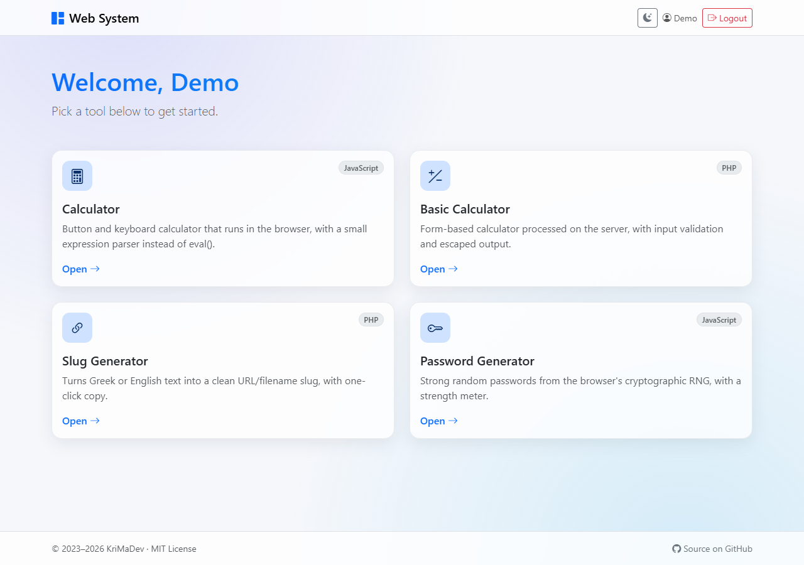
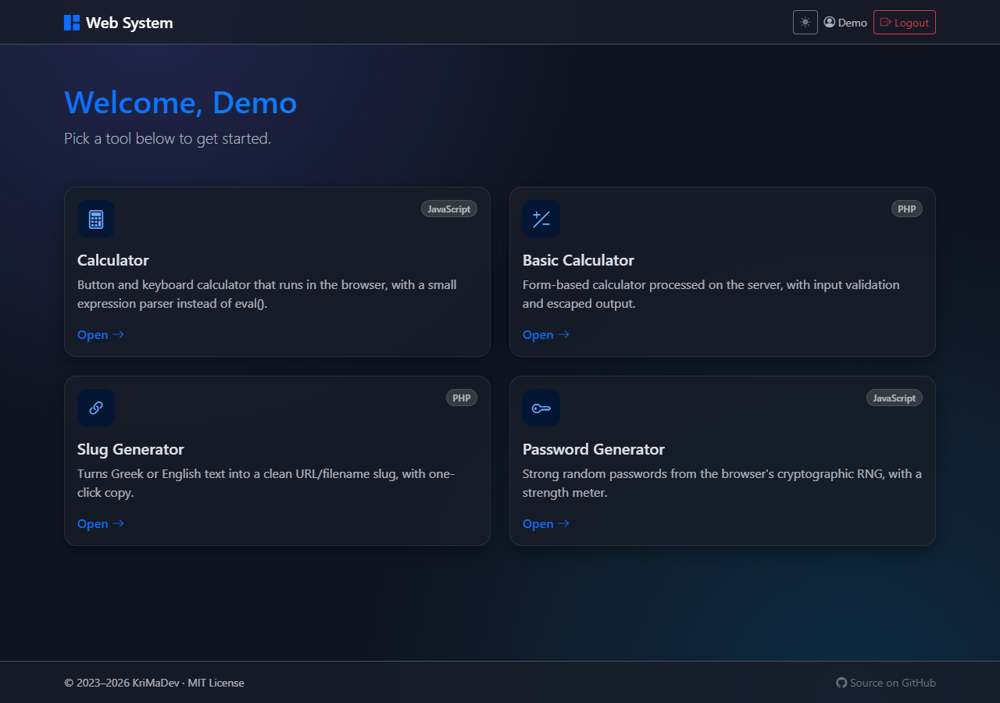
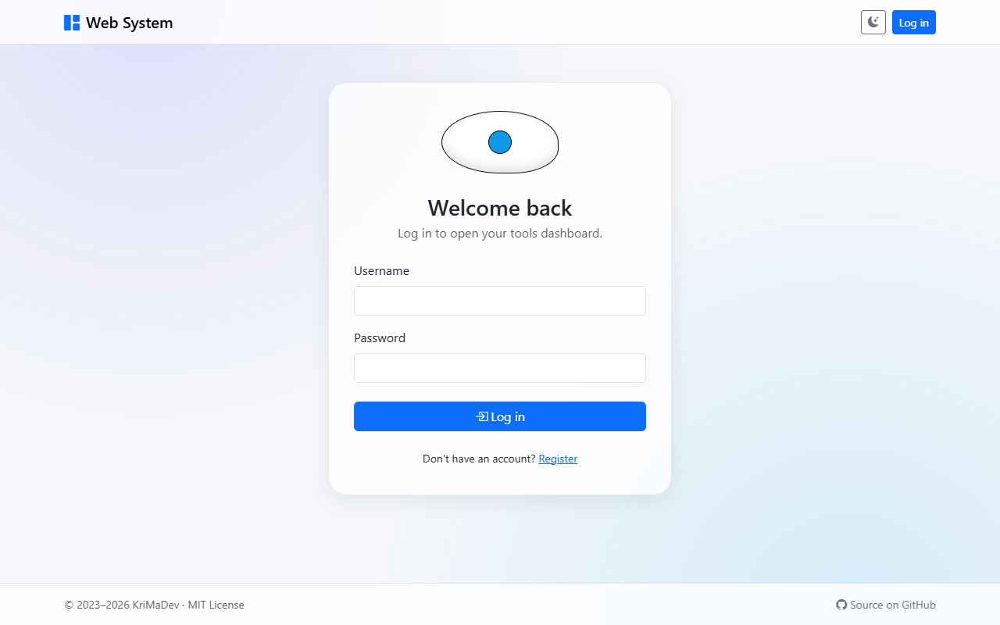
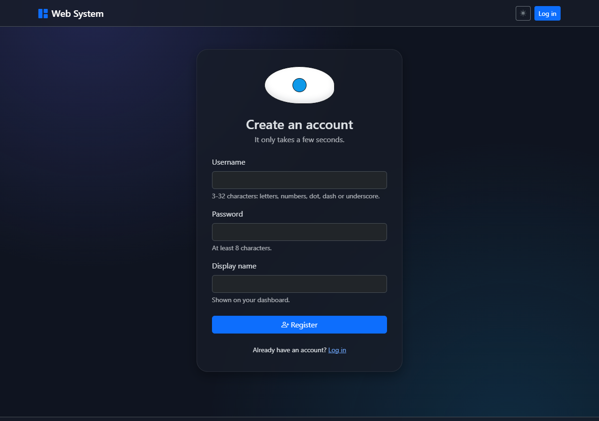
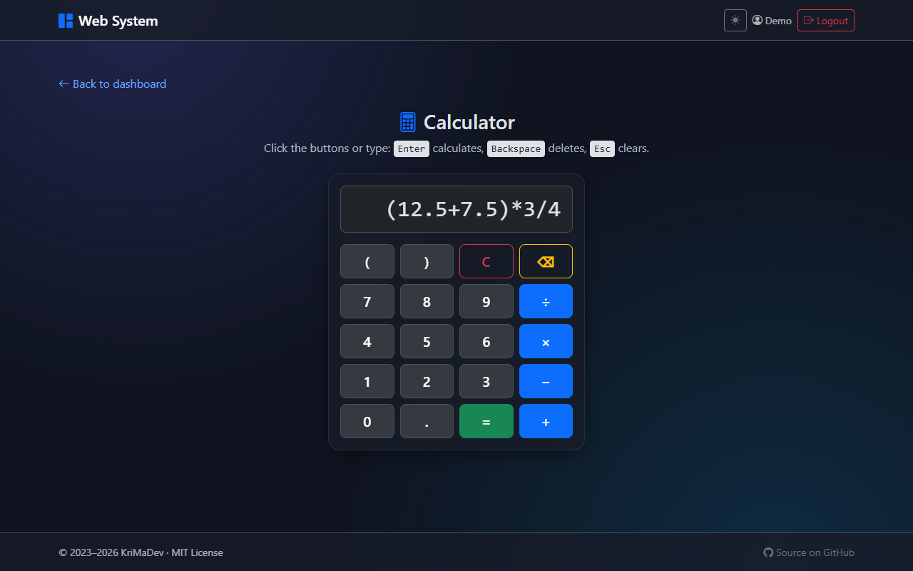
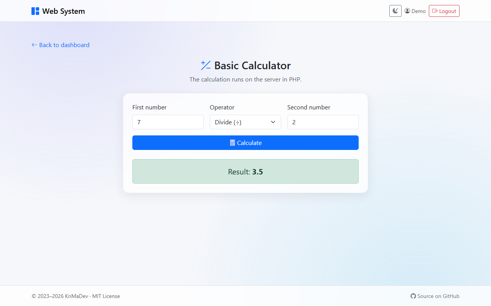
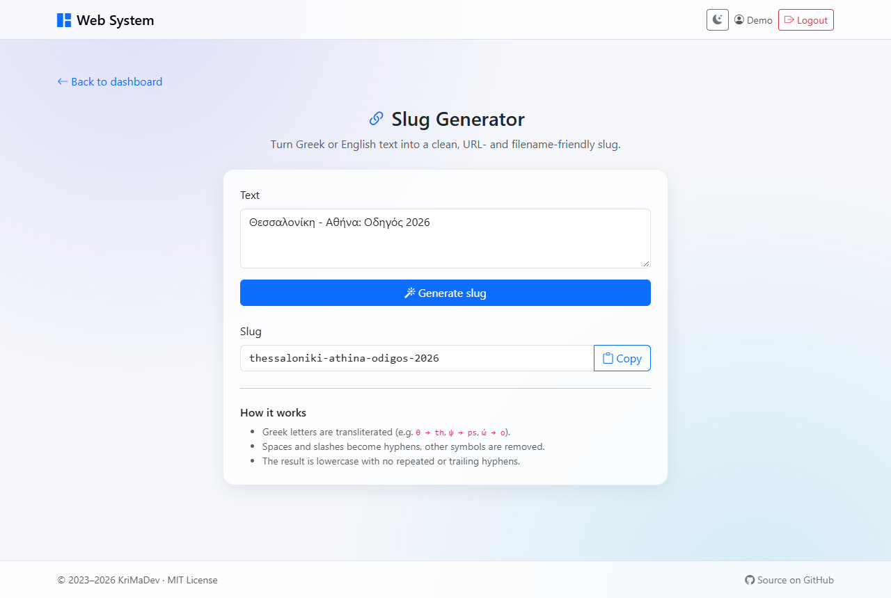
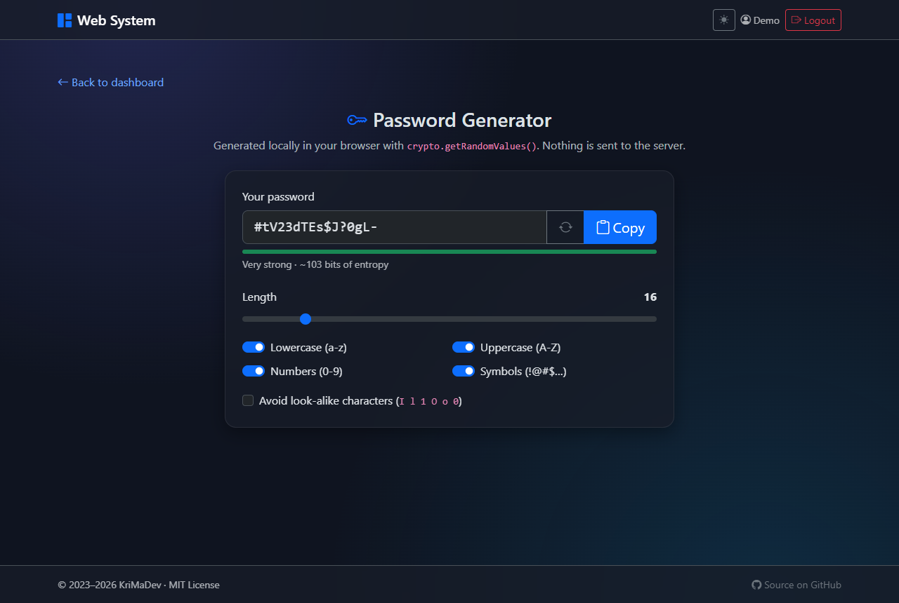

# Web System – Secure PHP Login & Tools Dashboard


A small web application in **plain PHP and MySQL (no framework)**: users register, log in and get a dashboard of handy tools. It has a **dark/light mode** and **security hardening**, and **starts with one command** using Docker.

It began in 2023 as my first project for learning Git and PHP. I later reworked it to apply what I've learned since: secure authentication, clean structure, configuration through environment variables, and reproducible setup. It's a learning project, built with production habits.

| Light mode | Dark mode |
|:----------:|:---------:|
|  |  |

---

## Contents

- [Features](#features)
- [Tools](#tools)
- [Tech Stack](#tech-stack)
- [Security](#security)
- [Getting Started](#getting-started)
- [How to Use](#how-to-use)
- [Project Structure](#project-structure)
- [Screenshots](#screenshots)
- [What I'd Add Next](#what-id-add-next)
- [License](#license)

## Features

- **Accounts**: register, log in and log out, with server-side validation and clear error messages
- **Dashboard**: one card per tool, with a personal greeting
- **4 built-in tools**: see [Tools](#tools)
- **Dark / light mode**: follows your system setting and remembers your choice; no flash on page load
- **Responsive UI** built with Bootstrap 5.3 and Bootstrap Icons
- **Security first**: prepared statements, password hashing, CSRF tokens, hardened sessions, output escaping ([details](#security))
- **One-command setup**: `docker compose up` starts the app and a MySQL database with the schema already imported

## Tools

| Tool | Runs in | What it does |
|------|---------|--------------|
| **Calculator** | JavaScript | Button and keyboard calculator. Expressions such as `(2+3)*4` are evaluated by a small **recursive-descent parser** instead of `eval()`, so input is never executed as code. |
| **Basic Calculator** | PHP | Form-based calculator processed on the server, with numeric validation and escaped output. |
| **Slug Generator** | PHP | Turns Greek or English text into a clean URL/filename slug (`Θεσσαλονίκη - Αθήνα` → `thessaloniki-athina`), with one-click copy. |
| **Password Generator** | JavaScript | Strong passwords from the browser's cryptographic RNG (`crypto.getRandomValues()`), using rejection sampling to avoid modulo bias, with a strength meter. Nothing is sent to the server. |

## Tech Stack

| Layer      | Technology |
|------------|------------|
| Backend    | PHP 8.3 (plain PHP, PDO) |
| Database   | MySQL 8.4 (MariaDB also works) |
| Frontend   | HTML, CSS, vanilla JavaScript, Bootstrap 5.3, Bootstrap Icons |
| Web server | Apache (`php:8.3-apache` Docker image) |
| Tooling    | Docker, Docker Compose, Git |

## Security

| Threat | How it's handled |
|--------|------------------|
| SQL injection | Every query uses **PDO prepared statements** with native (non-emulated) prepares |
| Password theft | Passwords are hashed with **`password_hash()`** (bcrypt) and checked with `password_verify()`. Old hashes are upgraded on login |
| Cross-site scripting (XSS) | Raw data is stored in the database and **escaped on output** with `htmlspecialchars()` (`e()` helper). Forms post to `action=""` instead of echoing `PHP_SELF` |
| Cross-site request forgery (CSRF) | Login, register and logout forms carry a per-session **CSRF token**, checked with `hash_equals()` |
| Session fixation / hijacking | `session_regenerate_id(true)` after login. Cookies are `HttpOnly`, `SameSite=Lax`, and `Secure` on HTTPS. Strict mode and cookie-only sessions are on |
| Username enumeration | One generic "invalid username or password" message, and similar response times for unknown users |
| Duplicate accounts | `UNIQUE` constraint on usernames; the database error is turned into a friendly message |
| Information leakage | Errors are **logged, never shown** to visitors. The Docker image uses the production `php.ini` and hides PHP/Apache versions |
| Clickjacking & MIME sniffing | `X-Frame-Options: DENY`, `X-Content-Type-Options: nosniff` and `Referrer-Policy` headers |
| Exposed files | `.htaccess` turns off directory listings and blocks dotfiles (`.git`, `.env`), config files, page partials and the SQL schema |
| Secrets in Git | Credentials come from environment variables. `config.php` and `.env` are git-ignored; only `*.example` templates are committed |
| Tampered CDN files | Bootstrap is loaded with **Subresource Integrity** (SRI) hashes |

## Getting Started

### Option A: Docker (recommended)

**Requirements:** [Docker Desktop](https://www.docker.com/products/docker-desktop/) on Windows/macOS, or Docker Engine with the Compose plugin on Linux.

```bash
git clone https://github.com/KriMaDev/web_system.git
cd web_system

# Optional: choose your own passwords/port (the defaults are fine for local use)
cp .env.example .env

docker compose up --build
```

Open **http://localhost:8080**. The first start downloads the images and imports the database schema, which can take a minute or two.

| Task | Command |
|------|---------|
| Follow the logs (incl. PHP errors) | `docker compose logs -f app` |
| Stop | `docker compose down` |
| Stop and delete the database | `docker compose down -v` |
| Apply code changes | `docker compose up --build` |

> **Windows note:** Docker Desktop needs WSL 2 and hardware virtualization (Intel VT-x / AMD-V) enabled in the BIOS/UEFI. If that isn't possible, use option B or C.

### Option B: XAMPP / WAMP / MAMP

1. Copy the project into your web root, e.g. `C:\xampp\htdocs\web_system`.
2. In phpMyAdmin, create a database named `krima_rep` (collation `utf8mb4_unicode_ci`) and import [`helpers/database/krima_rep.sql`](helpers/database/krima_rep.sql).
3. Copy `config.example.php` to `config.php` and adjust the database settings if needed (the defaults match XAMPP: user `root`, empty password).
4. Open **http://localhost/web_system/**.

### Option C: PHP's built-in server

Needs PHP 8.1+ with the `pdo_mysql` extension, plus a running MySQL/MariaDB with the schema imported (see option B, step 2).

```bash
# macOS / Linux
DB_HOST=127.0.0.1 DB_USER=root DB_PASSWORD=secret php -S localhost:8000
```

```powershell
# Windows PowerShell
$env:DB_HOST="127.0.0.1"; $env:DB_USER="root"; $env:DB_PASSWORD="secret"; php -S localhost:8000
```

Then open **http://localhost:8000**. The built-in server ignores `.htaccess`, so use it for local testing only.

### Configuration

All settings are environment variables (read by [`config.example.php`](config.example.php)):

| Variable | Default | Description |
|----------|---------|-------------|
| `DB_HOST` | `localhost` | Database host (`db` inside Docker) |
| `DB_PORT` | `3306` | Database port |
| `DB_NAME` | `krima_rep` | Database name |
| `DB_USER` | `root` | Database user |
| `DB_PASSWORD` | *(empty)* | Database password |
| `APP_FORCE_SECURE_COOKIES` | `0` | Set to `1` when served over HTTPS behind a proxy |
| `APP_PORT` | `8080` | Host port for Docker only |

## How to Use

1. **Register**: open the site and click *Register*. Choose a username (3-32 letters, numbers, `.`, `-`, `_`), a password (at least 8 characters) and a display name.
2. **Log in** with your username and password. You'll land on the dashboard, which greets you by your display name.
3. **Open a tool** by clicking its card. Every tool has a *Back to dashboard* link.
   - **Calculator**: click the buttons or type. <kbd>Enter</kbd> calculates, <kbd>Backspace</kbd> deletes, <kbd>Esc</kbd> clears.
   - **Basic Calculator**: enter two numbers, pick an operator, click *Calculate*.
   - **Slug Generator**: type or paste text, click *Generate slug*, then *Copy*.
   - **Password Generator**: a password is generated right away. Adjust the length and character types, use ↻ for a new one, and *Copy* to copy it.
4. **Switch theme** with the 🌙/☀️ button in the top-right corner. The choice is remembered.
5. **Log out** with the *Logout* button in the navbar.

## Project Structure

```
web_system/
├── index.php                    # Entry point → dashboard or login
├── km_login.php                 # Login form + authentication
├── km_register.php              # Registration form + validation
├── km_dashboard.php             # Tool dashboard (login required) + logout handler
├── km_conn.php                  # PDO database connection (errors are logged)
├── km_func.php                  # Helpers: config, sessions, CSRF, escaping, slug function
├── config.example.php           # Configuration template (reads environment variables)
├── partials/
│   ├── header.php               # Shared <head>, navbar, theme toggle
│   └── footer.php               # Shared footer and scripts
├── assets/
│   ├── css/styles.css           # Theme tokens and custom styles
│   └── js/                      # theme.js, app.js, eye.js, calculator.js, password-generator.js
├── test_scripts/                # The tools
│   ├── calculator.php
│   ├── basic_calculator.php
│   ├── slug_generator.php
│   └── password_generator.php
├── helpers/database/
│   └── krima_rep.sql            # Database schema
├── docs/screenshots/            # Images used in this README
├── Dockerfile
├── docker-compose.yml
├── .env.example
├── LICENSE
└── THIRD_PARTY_NOTICES.md
```

## Screenshots

| Login | Register (dark) |
|:-----:|:---------------:|
|  |  |

| Calculator | Basic Calculator |
|:----------:|:----------------:|
|  |  |

| Slug Generator | Password Generator |
|:--------------:|:------------------:|
|  |  |

## What I'd Add Next

- **Login rate limiting / temporary lockout** against brute-force attempts
- **Automated tests** (PHPUnit for the PHP helpers, Node tests for the JavaScript tools, browser tests for the login flow) running in **GitHub Actions**
- **Content Security Policy**: all page scripts already live in `assets/js/`, so a strict CSP is the next step
- **Static analysis and code style**: PHPStan and PHP_CodeSniffer (PSR-12)
- **Account settings**: change display name or password, and password reset by email
- **Front controller and autoloading** to replace the separate `km_*.php` page scripts as the project grows

## License

Released under the [MIT License](LICENSE). Third-party components (Bootstrap, Bootstrap Icons and the Docker base images) are covered by their own licenses; see [THIRD_PARTY_NOTICES.md](THIRD_PARTY_NOTICES.md).

---

Made by **[KriMaDev](https://github.com/KriMaDev)**. Started December 2023 as a Git/PHP learning project; refactored and extended in 2026.
